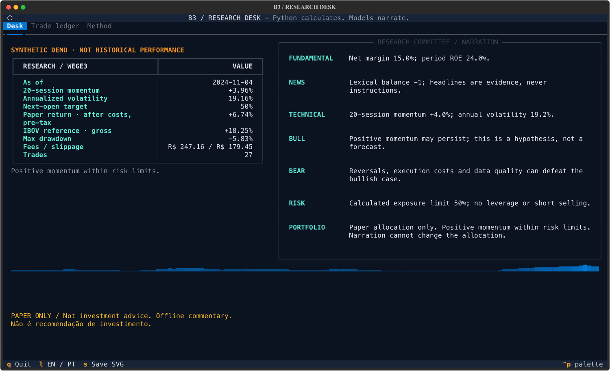
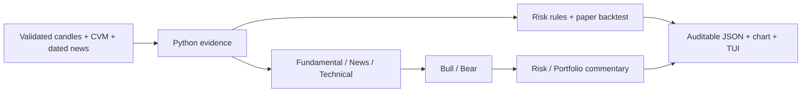
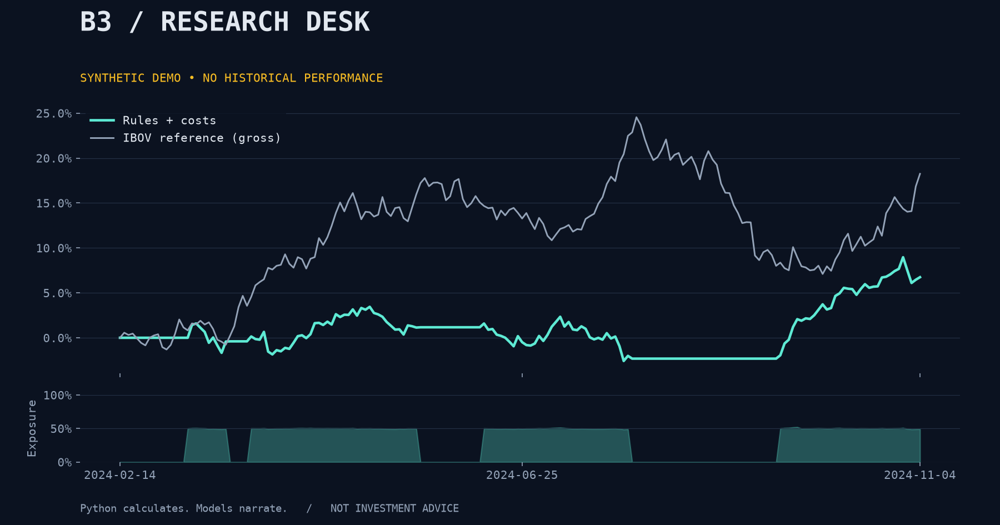

<div align="center">

# B3 Trading Agents

**Python calculates. Models narrate. You can audit both.**

A small research committee for Brazilian equities: CVM fundamentals, technical evidence,
bull/bear debate and a cost-aware paper ledger beside IBOV.

[](https://github.com/VictorPimentaDev/b3-trading-agents/actions/workflows/ci.yml)
[](pyproject.toml)
[](LICENSE)
[](#try-it)



</div>

> **Research and paper trading only. Not investment advice.** No broker connection, no order placement,
> no promise of returns. The screenshots use **synthetic** prices, fundamentals and headlines—not WEG
> history or actual IBOV performance. Language models can invent facts; review their commentary.

## Try it

Python 3.11+ and [uv](https://docs.astral.sh/uv/) are required for the commands below.

```sh
git clone https://github.com/VictorPimentaDev/b3-trading-agents.git
cd b3-trading-agents
uv run b3desk demo
uv run b3desk tui
```

Until the repository is made public, cloning requires access. Nothing is installed globally. The first
run installs dependencies; the **demo itself is offline** and needs no keys. With pip instead:
`python -m pip install -e .`, then `b3desk demo`. The project is not published to PyPI.

The demo writes `output/report.json` with inputs, decisions, fills, costs and commentary, plus
`output/equity.png`. In the TUI, use `Tab`/arrow keys for navigation, `l` to toggle EN/PT commentary,
`s` to save an SVG and `q` to quit. A wide terminal (about 120 columns) works best.

```sh
uv run b3desk backtest --cash 100000 --brokerage 4.90 --exchange-bps 3.2 --slippage-bps 5
uv run b3desk analyze --lang pt --out output/portuguese
uv run python -m b3desk --help
```

## What is actually multi-agent?

Seven named roles share immutable calculated evidence. The first three inspect fundamentals, news
and technicals; bull and bear discuss competing cases; risk and portfolio explain the deterministic
limits and paper allocation. Online, each role makes one model call and sees preceding commentary.
Offline, explicit templates provide the same walkthrough without pretending to be model reasoning.



**There is no arrow from model text back to portfolio decisions.** Headlines and prior commentary are
untrusted context. There are no agent tools or broker credentials. The risk manager computes vetoes
in Python; the corresponding LLM role explains them. News sentiment is a transparent toy lexical count,
not a trained classifier, and does not enter the allocation rule.

| Layer | Implemented |
| --- | --- |
| Evidence | 20-session momentum, 30-return sample volatility, CVM net margin and period ROE |
| Risk | Momentum/volatility/loss vetoes; smaller exposure with missing fundamentals |
| Execution | Previous-close signal → next-open fill; whole shares; buy affordability; long-only |
| Friction | Per-order brokerage, notional exchange fees, directional slippage, weighted cost basis |
| Benchmark | Same-date gross IBOV reference; equity, drawdown, zero-rate Sharpe, fee/slippage totals |
| Presentation | Rich CLI, Textual tabs/ledger, matplotlib chart, portable JSON report |

## Bring your own narrator

Choose a model your account supports; model identifiers are deliberately explicit. Keys are read from
the process environment, never from tracked files. The TUI stays local/offline; online narration is a
CLI action and makes **seven API calls** per run. Provider charges and terms apply.

```sh
# Set OPENAI_API_KEY securely in your shell, then:
uv run b3desk analyze --provider openai --model "$OPENAI_MODEL"

# Set ANTHROPIC_API_KEY securely in your shell, then:
uv run b3desk analyze --provider anthropic --model "$ANTHROPIC_MODEL"

# Start Ollama and pull a model first; no cloud key is needed:
uv run b3desk analyze --provider ollama --model "$OLLAMA_MODEL"
```

`OLLAMA_HOST` defaults to `http://localhost:11434`. An external provider receives the snapshot and
prior discussion; use public or properly authorized data. Errors do not print response bodies or keys.
The adapters use [OpenAI Chat Completions](https://developers.openai.com/api/reference/resources/chat),
[Anthropic Messages](https://platform.claude.com/docs/en/api/messages) and
[Ollama Chat](https://docs.ollama.com/api/chat). HTTP contracts are tested offline. Paid model calls are
not part of CI, and hosted models can still hallucinate even when the deterministic report is correct.

## Use market data and CVM filings

Fetch adjusted B3 candles plus the matching IBOV sessions (end date is exclusive):

```sh
uv sync --extra market
uv run b3desk fetch --ticker WEGE3 --start 2024-01-01 --end 2024-06-01 --out output/market.json
uv run b3desk backtest --data output/market.json --out output/market-report
```

This is an optional yfinance adapter. It is not a licensed market-data feed. There is no automatic
fallback that disguises synthetic data as live data. Without a filing, the rules disclose the missing
fundamentals and cap positive exposure at 25%.

Download a consolidated DFP ZIP from [CVM's official dataset](https://dados.cvm.gov.br/dataset/cia_aberta-doc-dfp),
verify the issuer code and publication date of that **specific revision**, then import it:

```sh
uv run b3desk import-cvm --data output/market.json --zip /path/to/dfp_cia_aberta_YEAR.zip \
  --cvm-code ISSUER_CODE --period YYYY-12-31 --available-on YYYY-MM-DD --out output/with-filing.json
uv run b3desk analyze --data output/with-filing.json
```

The placeholders must be replaced with verified values; the application cannot infer a trustworthy
publication date from a fiscal period. Consolidated DRE/BPP accounts and currency scale are validated.
Ambiguous revisions and missing accounts fail explicitly. Synthetic and real data cannot be mixed by
this importer. Curated news can be added to the dataset's `news` array as
`{"available_on":"YYYY-MM-DD","headline":"...","source":"https://..."}`. There is no news crawler.

## What the chart means



This synthetic run underperforms its reference. That is fine: the example demonstrates accounting,
causality and failure boundaries, not “AI alpha.” Fees, fixed rules and initial cash are visible.
IBOV is a frictionless reference, not an investable, cost-matched ETF. Final holdings are marked but
not liquidated. **Results are pre-tax**: there is no IR computation, CDI on idle cash, explicit dividend
ledger, order-book liquidity or production execution. Adjusted prices and revised filings can carry
hindsight bias even when the algorithm itself only looks backward.

Read the [full methodology](docs/METHODOLOGY.md) for equations, timing, B3 cost assumptions, source dates
and limitations. [The ledger screenshot](docs/ledger.png) shows signal dates beside fill dates.

## Develop and verify

```sh
uv sync --extra dev
uv run ruff check .
uv run ruff format --check .
uv run pytest -q
uv build
```

CI runs Python 3.11–3.13, checks future-data perturbation, fee arithmetic, CVM units/revisions,
provider contracts, CLI artifacts and TUI interaction, then installs the wheel outside the source tree.
It uses versioned synthetic fixtures and mock HTTP; no secrets, live prices or expensive model calls.
`uv.lock` captures dependency versions. See [CONTRIBUTING](CONTRIBUTING.md) and [SECURITY](SECURITY.md).

The UI screenshots come from `uv run python scripts/capture_desk.py`, which writes SVG exports of the
real app. PNG rendering is documented in [docs/VISUALS.md](docs/VISUALS.md).

## Em português

Uma mesa de pesquisa B3 pequena e auditável: o Python calcula os indicadores, aplica limites e simula
as operações; os modelos só narram. Tem CLI, terminal interativo, importação CVM, três provedores e
modo offline reproduzível. Os exemplos são sintéticos e não representam o histórico da WEG.

**Não é recomendação de investimento. Não opera dinheiro real.** O backtest é antes de impostos,
com simplificações de execução e dados que precisam de revisão. A parte interessante é poder seguir
cada decisão até sua evidência e verificar onde o método falha.

## Credits and license

The committee pattern is inspired by [TradingAgents](https://github.com/TauricResearch/TradingAgents)
and [ai-hedge-fund](https://github.com/virattt/ai-hedge-fund). This is an independent, original
implementation focused on B3/CVM and deterministic auditability; no upstream source was copied.
No affiliation or endorsement is implied. Code and synthetic fixtures: [MIT](LICENSE).
Imported datasets, models and services retain their own licenses and terms.
